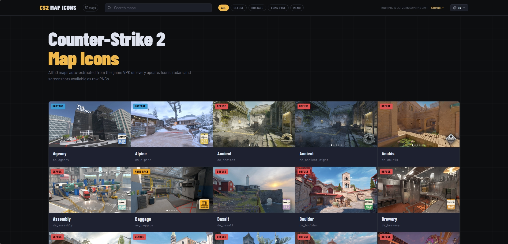
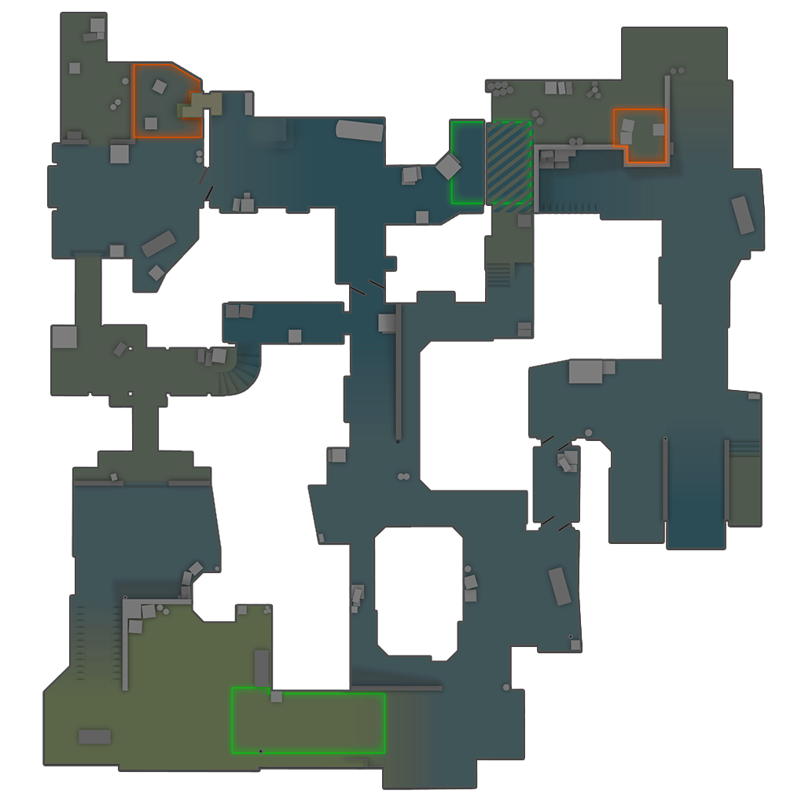

# CS2 Map Icons
 
<div align="center">
  
[](https://github.com/MurkyYT/cs2-map-icons/actions/workflows/update-icons.yml)
[](https://github.com/MurkyYT/cs2-map-icons/commits/main)
[](data/available.json)
[](https://github.com/MurkyYT/cs2-map-icons/stargazers)
 
**Always up-to-date Counter-Strike 2 map icons, radar images, in-game screenshots and overview (radar coordinate) data, extracted straight from the official game depot every time Valve ships an update.**
 
Use them as plain image URLs or JSON. No game files, VPK extraction or API key needed.
 
### [Browse the live gallery](https://murkyyt.github.io/cs2-map-icons/)
 
All maps, filterable by mode, auto-rebuilt on every Valve depot update.
 
⭐ **Find this useful? [Star the repo](https://github.com/MurkyYT/cs2-map-icons) so other CS2 developers can find it.**
 
</div>
<br>
<div align="center">
  
</div>
<br>

## Quick Start
 
Every asset is a stable URL. Drop it into an `` tag, your app or your overlay:
 
```html

```
 
To get everything for a map in one request (icon, radars, screenshots and radar coordinates), read `data/available.json`:
 
```js
const url = 'https://raw.githubusercontent.com/MurkyYT/cs2-map-icons/main/data/available.json';
const { maps } = await (await fetch(url)).json();
 
const dust2 = maps['de_dust2'];
console.log(dust2.display_name);   // map name
console.log(dust2.path);           // icon URL
console.log(dust2.radar_paths);    // radar image URLs
console.log(dust2.thumb_paths);    // screenshot URLs
```
 
## Available Assets
 
| Type | Path pattern | Notes |
|------|-------------|-------|
| **Icon** | `/images/<map>.png` | Always available |
| **Radar** | `/images/radars/<map>_radar_psd.png` | Multi-level maps include `_lower_` variant |
| **Thumbnail** | `/images/thumbs/<map>_N_png.png` | Multiple screenshots per map |
| **Radar info** | `/data/radar_info/<map>.txt` | Raw overview file (pos_x, pos_y, scale, verticalsections, etc.) |
 
## Usage
 
### Direct URLs
 
**Icons**
```
https://raw.githubusercontent.com/MurkyYT/cs2-map-icons/main/images/de_dust2.png
https://raw.githubusercontent.com/MurkyYT/cs2-map-icons/main/images/de_mirage.png
```
 
**Radars**
```
https://raw.githubusercontent.com/MurkyYT/cs2-map-icons/main/images/radars/de_dust2_radar_psd.png
https://raw.githubusercontent.com/MurkyYT/cs2-map-icons/main/images/radars/de_nuke_lower_radar_psd.png
```
 
**Thumbnails**
```
https://raw.githubusercontent.com/MurkyYT/cs2-map-icons/main/images/thumbs/de_dust2_1_png.png
https://raw.githubusercontent.com/MurkyYT/cs2-map-icons/main/images/thumbs/de_inferno_3_png.png
```
 
**Radar info**
```
https://raw.githubusercontent.com/MurkyYT/cs2-map-icons/main/data/radar_info/de_dust2.txt
```
 
### Map Data
 
Each map entry in `data/available.json` includes the icon path, hash, first seen date, radar paths, thumbnail paths and parsed radar info (pos_x, pos_y, scale, rotate, zoom, verticalsections) where available. This is the easiest way to pull everything for a given map in one request.
 
### Tips for apps and bots
 
- Fetching these files over HTTPS at run time is fine, but **cache them** (in memory, on disk or in your CDN) instead of requesting them on every launch or every page view.
- If you need a pinned version, **pin to a commit or release tag** in the URL instead of `main`. Each Valve update is published as a release (`manifest-<id>`), so your app won't change when a map's radar does.
- Don't clone the whole repo on every CI run. Download only the files you need.
## Full Map List
 
Auto-updated list of all maps ever scraped:
 
[](data/available.csv)
[](data/available.json)
[](data/available.md)
 
## Used By
 
- [zenojunior/cs2d](https://github.com/zenojunior/cs2d) - Browser-based 2D CS2 demo viewer. Playback, heatmaps and grenade trajectories.
- [KPR23/rnkd](https://github.com/KPR23/rnkd) - Uses the map thumbnails in its mobile app.
- [yuma-dev/setsu](https://github.com/yuma-dev/setsu) - Uses the map icons in its CS2 integration.
- [Bafak/cs2-nade-vault](https://github.com/Bafak/cs2-nade-vault) - Grenade lineup viewer using the radar images.
- [abdurryy/CerlockCS](https://github.com/abdurryy/CerlockCS) - Downloads and caches radar images and overview files.

Using these assets in your project? [Open an issue or PR](https://github.com/MurkyYT/cs2-map-icons/issues) and get listed here.
 
## License and Attribution
 
Map icons, radars, thumbnails and overview data are property of **Valve Corporation**. This repository is not affiliated with or endorsed by Valve; it simply provides automated access to publicly available game resources.
 
If you use the assets, credit is appreciated: a link back to this repository is enough.
 
## Contributing
 
Found a bug or want to improve the scraper? Pull requests are welcome!
 
## Star History
 
<a href="https://www.star-history.com/?repos=MurkyYT%2Fcs2-map-icons&type=date&legend=top-left">
 <picture>
   <source media="(prefers-color-scheme: dark)" srcset="https://api.star-history.com/chart?repos=MurkyYT/cs2-map-icons&type=date&theme=dark&legend=top-left&sealed_token=2_EKuu1KwWirotxERvii12Y87hJv1fU87NJ0oteq7DqBkoIFcnJWvltCpQ1DW9Fz4Nezhy2lVab9NM11bi0riPk5M_c3vZ4P-wMoC0acS0t8un34bSEqZQ" />
   <source media="(prefers-color-scheme: light)" srcset="https://api.star-history.com/chart?repos=MurkyYT/cs2-map-icons&type=date&legend=top-left&sealed_token=2_EKuu1KwWirotxERvii12Y87hJv1fU87NJ0oteq7DqBkoIFcnJWvltCpQ1DW9Fz4Nezhy2lVab9NM11bi0riPk5M_c3vZ4P-wMoC0acS0t8un34bSEqZQ" />
   
 </picture>
</a>
---
 
<div align="center">
  
If you find this useful, please **[star the repo](https://github.com/MurkyYT/cs2-map-icons)**!
 
</div>
 